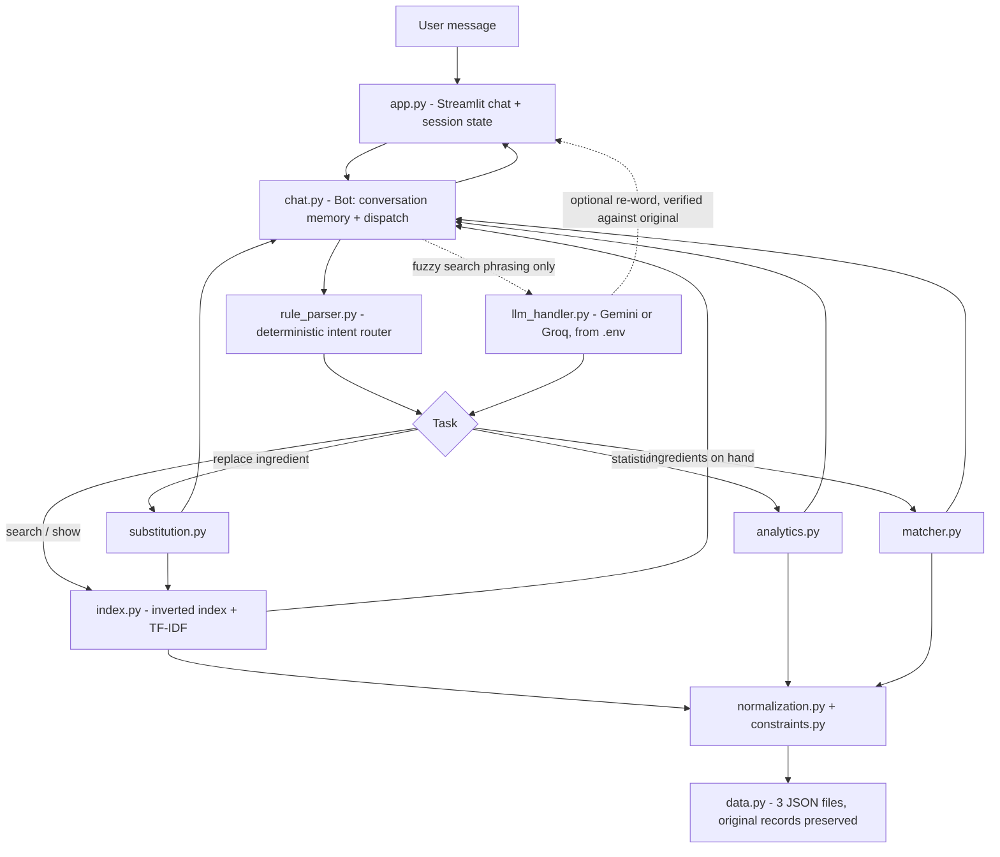

# Recipe Intelligence Chatbot

A conversational chatbot over the **Recipe Box** dataset (all three JSON files, 122,971 usable recipes) that can
**search** recipes, **analyse** the dataset, **match** recipes to the ingredients you have, and **adapt** a recipe by
substituting an ingredient, with every answer grounded in retrieved records.

The design rule: **Python does the facts, the LLM only helps with language.** Counts, percentages, rankings, filtering,
ingredient matching and constraint checks are computed deterministically in Python over the complete filtered dataset.
The LLM (Gemini or Groq, your choice) is optional: it can help understand a message and can re-word a finished answer,
and a re-worded answer is rejected if it adds a number or changes a recipe ID.

## Features
- **Task 1 - Search and factual Q&A:** search by dish, ingredients or natural language; follow-ups keep earlier restrictions
  ("Find pasta" -> "I cannot have dairy" -> "only with tomato" -> "show the first one"); statistics (counts, percentages,
  common ingredients, mean/median ingredient count, ranking by instruction steps) that always print the filters, the number
  of recipes analysed and the calculation. Attributes the dataset does not have (calories, cooking time, servings, cost,
  ratings) are refused, never guessed.
- **Task 2 - Ingredient matching:** ingredients (optionally with quantities), excluded ingredients, max steps and
  preferences. Hard constraints are applied first and never relaxed silently; "NO MATCH" is reported when nothing qualifies.
  Each result shows matched / missing ingredients, steps, score and why it ranks where it does.
- **Task 3 - Evidence-based substitution:** finds similar recipes in the local dataset that do not use the ingredient,
  counts which substitutes they use, cites recipe IDs, labels the evidence STRONG / WEAK / NONE / CONFLICTING, and returns an
  updated ingredient list and revised instructions with predicted (not verified) effects.
- **Streamlit UI:** chat, sidebar with dataset info and API status, New Chat / Clear Chat, a live view of the conversation
  memory, recipe cards with full ingredients and instructions.

## Architecture


**Flow of one message:** the rule parser turns the text into a structured intent (task, dish, include/exclude, max steps,
ingredients on hand ...). Specific tasks (matching, statistics, substitution) always use the rule parser; the LLM is only
consulted for plain search/refinement phrasing. The Bot merges the intent into the session memory, calls the matching
Python module, and formats a grounded answer. The UI shows it with recipe cards.

## Technology stack
Python 3.9+, Streamlit (UI), NumPy and scikit-learn (TF-IDF retrieval), Google Gemini or Groq (optional, via `.env`),
python-dotenv, pytest. Pandas and FAISS were deliberately not used: plain Python structures and an inverted index are
enough for 123k recipes, and exact filters are needed for correct statistics.

## Project structure
```
app.py                  Streamlit chat interface
src/
  data.py               loads the 3 JSON files; stable IDs; original records preserved; step counting
  normalization.py      ingredient-line normalisation, strict/broad matching, quantity parsing
  constraints.py        dietary/allergen word lists (text screening only)
  index.py              inverted index (exact filters) + TF-IDF (relevance ranking), cached on disk
  rule_parser.py        message -> structured intent; detects unsupported attributes
  chat.py               Bot: conversation memory, task dispatch, answer formatting, CLI
  analytics.py          counts, percentages, common ingredients, mean/median, ranking by steps
  matcher.py            ingredient-based matching and ranking
  substitution.py       evidence-based substitution
  llm_handler.py        one interface for Gemini or Groq (provider chosen in .env)
tests/                  unit tests on a tiny synthetic dataset that mimics the real file quirks
evaluation/             run_eval.py, eval_set.json, results.md, transcripts.md, evaluation_report.md
scripts/download_data.py
data/                   the three JSON files (not committed)
.env.example            template for API keys
```

## Dataset
Recipe Box: https://eightportions.com/datasets/Recipes/ - use the three files
`recipes_raw_nosource_ar.json`, `recipes_raw_nosource_epi.json`, `recipes_raw_nosource_fn.json`.
Recipe ID = `<source>:<original key>` (for example `ar:nvQzTEX.J7/2LmKnF8KjsR6aCqNHGxO`). Original title, ingredient lines
and instructions are never modified; the `ADVERTISEMENT` scrape marker in the ar file is removed only from the derived
fields used for matching and display. 2,193 records without a title or ingredients are skipped (and counted).

## Installation
```bash
git clone <this repo> && cd <repo>
python -m venv venv && venv\Scripts\activate        # Windows  (macOS/Linux: source venv/bin/activate)
pip install -r requirements.txt
```
Put the three JSON files in `data/` (run `python scripts/download_data.py`, or download them manually from the dataset page).

## Environment variables
Copy `.env.example` to `.env` and fill in **one** provider (the app also works with no key, in rule-based mode):
```
LLM_PROVIDER=groq            # gemini or groq
GEMINI_API_KEY=              # https://aistudio.google.com/apikey
GROQ_API_KEY=                # https://console.groq.com/keys
GEMINI_MODEL=gemini-2.5-flash
GROQ_MODEL=llama-3.3-70b-versatile
```
`.env` is git-ignored. Never commit API keys.

## Run
```bash
streamlit run app.py                       # web UI (first start builds a cache: a few minutes)
python -m src --data data [--no-llm]       # command-line chat
pytest -q tests                            # unit tests
python evaluation/run_eval.py --data data [--baseline]   # reproducible evaluation (--baseline needs an API key)
```

## Example conversations
```
you> Find a penne pasta recipe.            -> top 5 with IDs ("3460 of 122971 recipes satisfy the filters")
you> I cannot have dairy.                  -> same search, dairy excluded, each result shows its dairy check
you> How many recipes contain both garlic and onion? What percentage is that?
     -> 15920 of 122971 = 12.95%, with filters, denominator, calculation and normalisation rule
you> I have eggs, onions, tomatoes, and rice. Suggest five recipes with no peanuts and at most six steps...
     -> ranked list, matched / missing ingredients, steps; "Exclude eggs too" updates it
you> Replace cream in this pasta recipe without dairy.
     -> local evidence (recipe IDs), WEAK label, updated ingredients, revised steps, predicted effects
you> How many calories does the first one have?
     -> NOT AVAILABLE IN THE DATASET - no estimate is given
```

## Evaluation
Nine reproducible conversations (`evaluation/eval_set.json`), all passing on the full dataset:
multi-turn dairy follow-up, aggregate statistic, ranking by steps, missing-attribute refusal, ingredient matching with a
follow-up exclusion, a guaranteed no-match case, substitution with weak evidence, a dairy-free cream substitution, and a
substitution the system refuses to invent.

On "how many recipes contain both garlic and onion?": the system computes **15,920** (12.95%); a naive substring search
gives **20,245** (it also counts garlic powder, onion powder, green onions); one-shot LLMs (Gemini asked plainly, Groq told to estimate) both declined because they have no access to the data and
cannot compute it. Full results, what worked, what failed and why: **`evaluation/evaluation_report.md`**.

## Limitations
- Dairy/peanut/etc. screening is a word list on recipe text, not medical advice; it can miss hidden ingredients.
- Ingredient matching is name-level: "egg noodles" can be counted as "egg", and a few records contain instruction sentences
  in the ingredient list. Quantities are compared only when units are comparable; otherwise "not verified".
- Substitution evidence comes from the 400 most similar recipes (TF-IDF); the substitute table, ratios and effects are curated
  rules of thumb (labelled as external). Revised instructions are produced by word replacement and may not fit the new
  ingredient perfectly. No internet search is used.
- Step counts depend on how instructions are split (lines, or sentences when there is one line); some records have 0 or 1 steps.
- Duplicates across the three files are not removed (stated in every answer).

## AI tools disclosure
Claude (Anthropic) was used to help draft the code structure, unit tests, evaluation script and documentation, and to review
the code against the assignment and the real data. I ran the unit tests, the command-line chat and the Streamlit app, and ran the
evaluation on the full 122,971-recipe dataset. While testing I found problems and had them fixed: the LLM intent parser misrouting
"I have peanut butter. Find recipes with no peanuts." (the rule-based router now decides specific tasks), matching that ranked
one-ingredient recipes first (now ranked by how many of my ingredients are used), and substitution demos that picked a recipe
without the ingredient. The results and transcripts in `evaluation/` come from my own runs.
